<p align="center">
  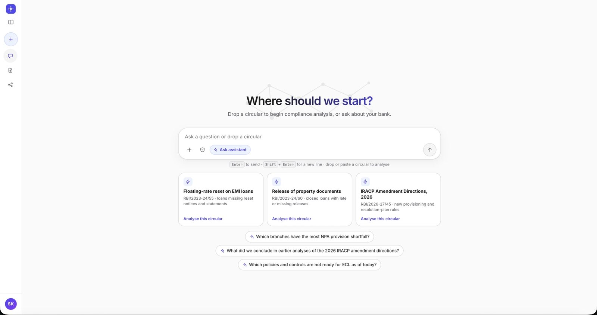
</p>

# Anuvi: Autonomous Compliance Engineer for Banking

**Anuvi reads a regulatory circular and tells the bank what it touches, where it is already in breach, what it costs,
and what to do, with an audit trail for every number.** A circular goes in. A verified impact report comes out. A
compliance officer approves every action before anything is sent.

Built for the **Google Cloud AI Builder Cup 2026** (BFSI theme). The repository is named `yukdhis`; the product is **Anuvi**.

| | |
| --- | --- |
| **Live demo** | https://project-b3f4c857-8b43-4c3b-84c.web.app/ (sign in with Google) |
| **Demo video** | https://youtu.be/ldPnE9XgWg4 |
| **Stack** | 100% Google Cloud: Gemini 2.5 on Vertex AI, Google ADK, Document AI, Spanner Graph, Cloud SQL, Cloud DLP, Cloud Run, Firebase |
| **Data** | Synthetic bank and sample RBI circulars. No real customer data. |

---

## Why it matters

When RBI issues a circular, a bank has to answer three questions: *what changed, who does it hit, and what does it cost?*
Today each answer is a manual project: reading, cross-checking spreadsheets, and chasing owners. Generic AI tools
summarise the circular but cannot measure the impact in the bank's own records, and pasting customer data into a public
model is not acceptable.

Anuvi answers all three questions, and shows the evidence:

- **Reads the circular** and extracts obligations, thresholds, effective dates and verbatim citations.
- **Maps the impact** across products, processes, controls, teams and branches in a bitemporal knowledge graph.
- **Measures the breach** with guarded, read-only SQL over sanitised views. The numbers come from code, not from the model.
- **Proposes remediation** (borrower notices, branch alerts, control changes) for a compliance officer to approve.
- **Protects customer data**: no customer identifier reaches the model.

---

## See it working

| | |
| --- | --- |
| 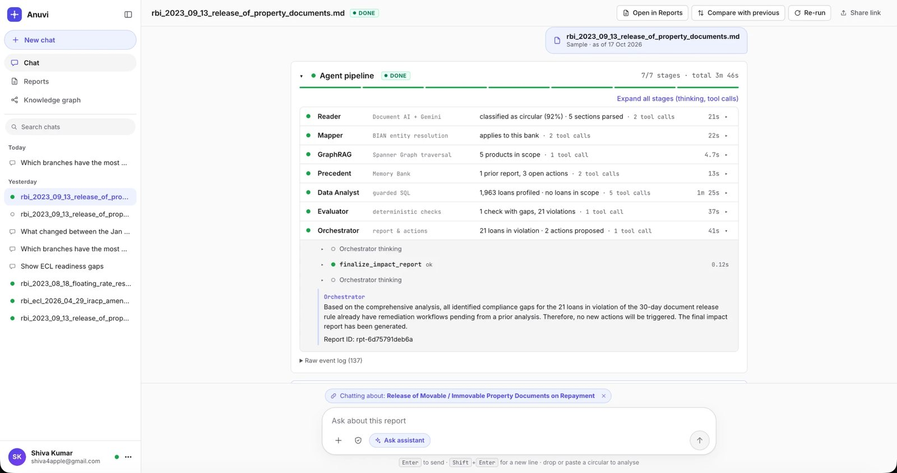 | 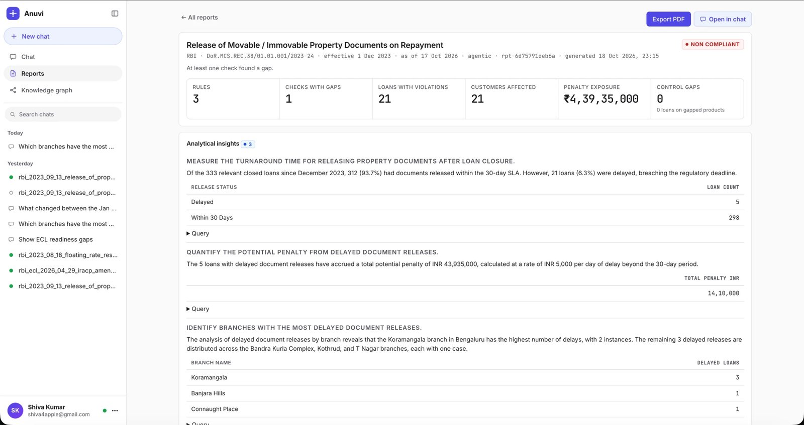 |
| **Seven agents run on a circular.** Each stage shows its result, timing and tool calls. | **Impact report.** Rules, violations, penalty exposure, the blast radius and the SQL behind every figure. |
| 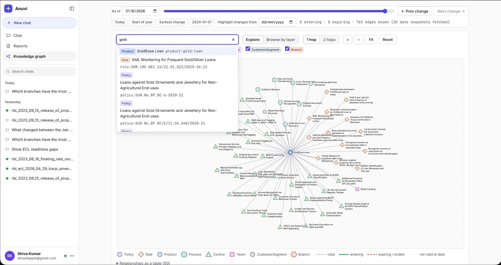 | 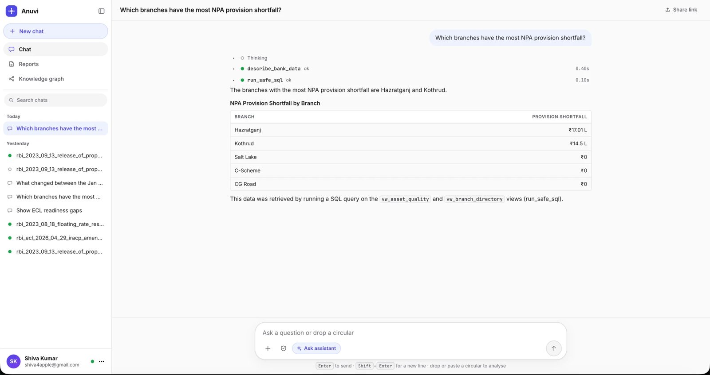 |
| **Knowledge graph with time travel.** Search a product, rule or control and see what it touches as of any date. | **Assistant.** Follow-up questions are answered from guarded SQL and the graph, not from guesswork. |
| 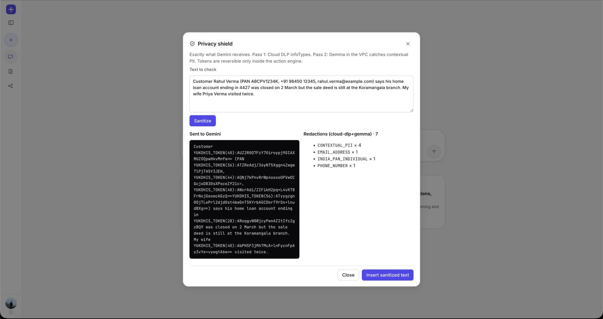 | |
| **Privacy shield.** Exactly what Gemini receives: customer identifiers are tokenised before any model call. | |

---

## Results on the demo bank

Synthetic data (20 branches, 12 products, about 2,500 customers, about 4,000 loans, about 16,400 events). Figures come from
the deterministic runner and the live Cloud Run deployment.

| Circular | What the engine finds |
| --- | --- |
| **RBI/2023-24/60**: release property documents within 30 days of full repayment | 5 products in scope; **21 loans** breached the 30-day limit; **₹4.39 Cr** penalty exposure at ₹5,000 per day of delay. The report lists the blast radius, owners and proposed borrower notices and branch alerts. |
| **RBI/2023-24/55**: floating-rate reset on EMI loans | Gaps in rate-reset notices and reset statements, and a missing fixed-rate option on one product. Graph time travel shows the switch expired on 1 Jul 2024. |
| **RBI 2026 IRACP amendment directions** | Provisioning and resolution-plan rules mapped to asset-quality data for the branch view. |
| **RBI 2026 ACPIR (ECL) directions** | Rules that take effect after the analysis date are reported as **UPCOMING**, with readiness not assessed. |

---

## How it works

### System context

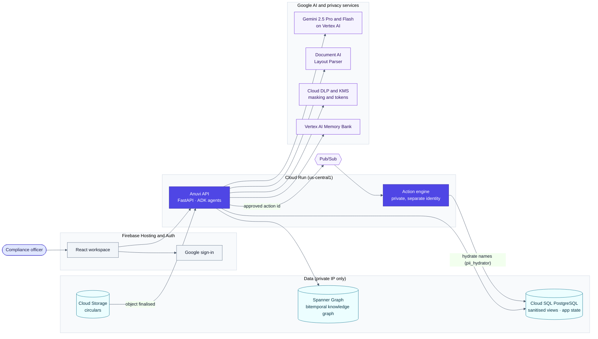

### Agent pipeline

Seven ADK agents run in sequence. Two of them run in parallel. Every agent passes structured results through session
state, not prose.

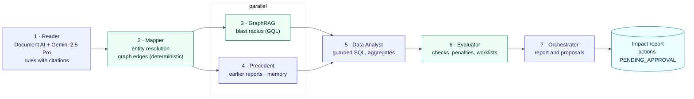

Green boxes are **deterministic code**; indigo boxes use the language model. The numbers come from code. The model
routes, reasons, writes guarded queries and drafts the narrative.

### Privacy: what reaches the model

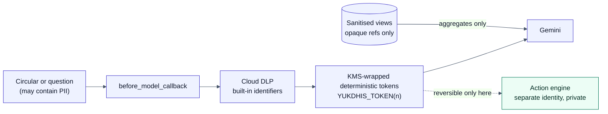

Customer names, contact details and account numbers never reach the model. Tokens reverse only inside the action engine,
under its own service account.

### Human approval

Nothing is sent without an officer's decision.

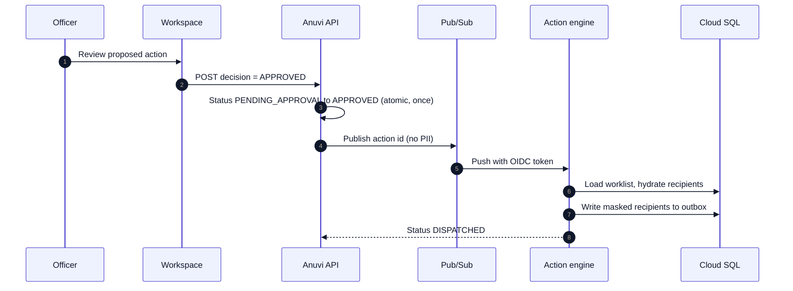

### Knowledge graph

Every rule is linked to what it governs, so an impact can be traced from the circular to the owner. The graph is
bitemporal: each edge has a business-time validity and a system-time record, so it can answer "what was true on that date".

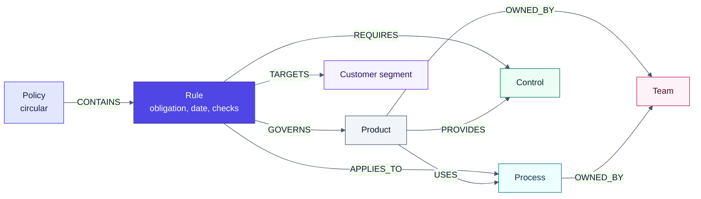

---

## Guardrails: why the numbers can be trusted

| Concern | How Anuvi handles it |
| --- | --- |
| **Numbers come from code** | Counts, penalties, worklists and gap statuses are computed by parameterised deterministic checks. The model never writes a figure. |
| **No PII to the model** | Cloud DLP masks built-in identifiers before every model call. Agents query sanitised views that expose opaque references only. |
| **Read-only SQL** | Every query passes an AST guard (sqlglot): one SELECT, views only, no PII columns, no `SELECT *`. The database role is read-only as well. |
| **Fail closed** | A rule whose scope cannot be resolved governs nothing and reports `INCONCLUSIVE`. It never shows a false `COMPLIANT`. |
| **Not yet effective** | A rule that takes effect after the analysis date is reported as `UPCOMING`, with readiness not assessed. |
| **Permission, not obligation** | `MAY` rules are not evaluated as obligations. |
| **Human approval** | Every remediation is a proposal in `PENDING_APPROVAL` until an officer approves it. A rule with an unresolved scope cannot be approved. |
| **Audit trail** | Every engine call logs the model's intent and the query it ran. Officer decisions are recorded with the officer's email. |
| **Network isolation** | Cloud SQL has private IP only. The action engine has private ingress and its own service account. Secrets are in Secret Manager. |

---

## Google Cloud services

| Area | Services |
| --- | --- |
| Models | Gemini 2.5 Pro and Flash on Vertex AI, `text-embedding-005`, Vertex AI Memory Bank |
| Agents | Google Agent Development Kit (ADK): sequential and parallel agents, session state, tools |
| Documents | Document AI Layout Parser |
| Privacy | Cloud Data Loss Prevention (Sensitive Data Protection), Cloud KMS, Secret Manager |
| Data | Spanner Graph (bitemporal property graph, GQL), Cloud SQL for PostgreSQL 16 (private IP, IAM auth), Cloud Storage |
| Compute and events | Cloud Run, Pub/Sub, Eventarc, Cloud Scheduler, Cloud Build, Artifact Registry |
| Identity and UI | Firebase Authentication, Firebase Hosting, React 19, TypeScript, Vite |

---

## Repository map

| Path | Purpose |
| --- | --- |
| `agents/compliance_coordinator/` | The seven-agent ADK pipeline and its tools |
| `agents/compliance_assistant/` | Chat assistant over runs, reports, graph time travel and guarded SQL |
| `api/` | FastAPI service: runs, streaming events, approvals, chat, Eventarc and Pub/Sub endpoints |
| `pipeline/` | Stage functions shared by the agents and the deterministic runner |
| `ingestion/` | Document AI parsing, Gemini extraction, validator, circular watcher |
| `knowledge_graph/` | BIAN ontology, bitemporal store, mapper, traversal, control canonicaliser |
| `bank_mcp_server/` | Secure execution engine, SQL guard, Cloud SQL access, action engine |
| `privacy/` | DLP and tokenisation, model callback |
| `core/` | Configuration, typed contracts, application store, Gemini client |
| `web/` | React workspace for Firebase Hosting |
| `infrastructure/` | `gcp/deploy.sh` (gcloud only), Spanner DDL, Cloud SQL schema and roles |
| `data/` | Sample RBI circulars, synthetic bank, ontology packs |
| `docs/` | Design, deployment, ontology, evaluation reports, screenshots |

---

## Run locally

Runs offline with no cloud account. Components use local backends (SQLite, deterministic mode) by default.

```bash
python3 -m venv venv && source venv/bin/activate
pip install -r requirements.txt
python scripts/run_demo.py                 # end-to-end run on a sample circular, no LLM
```

```bash
cd web && npm install && npm run build && cd ..
uvicorn api.main:app --port 8080           # open http://localhost:8080
```

Set `GOOGLE_CLOUD_PROJECT` (with `gcloud auth application-default login`) to enable the agentic mode with Gemini and the
chat assistant. Use `npm run dev` in `web/` for hot reload; it proxies to port 8080.

Tests: `python -m pytest -q` (more than 400 tests).

## Deploy to Google Cloud

```bash
cp infrastructure/gcp/config.env.example infrastructure/gcp/config.env   # set PROJECT_ID and options
bash infrastructure/gcp/deploy.sh all
```

Read [docs/deployment.md](docs/deployment.md) first. It covers the order of steps, costs (Spanner Enterprise, Cloud SQL,
and an optional GPU endpoint for Gemma), and the Firebase Authentication setup. The full design is in
[docs/design.md](docs/design.md).

## Limitations

Anuvi is a working prototype on synthetic data, not a production system. The main open items are documented in
[docs/design.md §12](docs/design.md): contextual-PII detection relies on a heuristic while the Gemma redactor is off,
extraction is not cached, and the Treasury and capital domains are not built yet. Its outputs are decision support:
every rule starts for review, and every action waits for a compliance officer.
