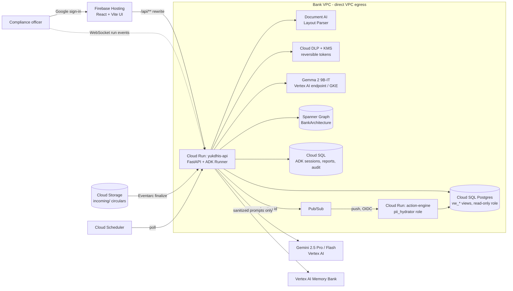

# Architecture

## Google Cloud deployment

## Agents and state

ADK `SequentialAgent` → `reader → mapper → ParallelAgent[graphrag, precedent] → data_analyst → evaluator → orchestrator`.
Agents pass structured results through **session state** (`document`, `extraction`, `mappings`, `blast_radius`,
`data_profile`, `results`, `actions`, `report_id`), persisted by `DatabaseSessionService` on Cloud SQL. Each tool is a
thin wrapper over `pipeline/stages.py`. The deterministic runner calls the same stages without an LLM, so
both modes produce identical numbers. After each run the session is added to Vertex AI Memory Bank. The precedent
agent (`load_memory`) and the chat assistant (`preload_memory`) recall it later, e.g. "Koramangala was flagged
last week and the alert is still pending".

| Agent | Tools | Guarantees |
| --- | --- | --- |
| Reader | `parse_regulatory_document`, `extract_and_validate_rules` | Gemini `response_schema=ExtractedPolicy`. The validator requires verbatim citations, ISO dates, and checks drawn from the ontology, and sends errors back for one retry. Approved templates are the source of record and Gemini is scored against them. |
| Mapper | `get_graph_ontology`, `map_rules_to_graph` | Product selection comes from attribute filters, the regulatory glossary ("personal loans" = all retail), and scored entity resolution. Unknown controls are created as `needs_review`. |
| GraphRAG | `traverse_blast_radius`, `run_graph_query` (Spanner) | GQL reads only, `@tenant_id` bound by the engine, `LIMIT 200`. |
| Precedent | `recall_precedents`, `load_memory` | Prior reports and pending actions for the same policy. |
| Data Analyst | `profile_impacted_portfolio`, `run_safe_sql` | sqlglot AST guard: one SELECT, `vw_*` views only, no PII columns, aggregate-only, no identifier grouping, LIMIT 100, transpiled to the target dialect. |
| Evaluator | `evaluate_compliance`, `fetch_anonymized_samples` | Parameterised queries. Row-level worklists stay in the VPC and only the `worklist_id` reaches the model. Samples use session tokens. |
| Orchestrator | `trigger_compliance_workflow`, `finalize_impact_report` | Workflows are proposals (`PENDING_APPROVAL`). Gaps the model missed get deterministic proposals. |

## Executable rule schema

`Rule.checks[]` is the condition logic. It has three kinds, each compiled to a deterministic query:

- `control_required(capability)`: the graph has no `PROVIDES` edge from the product to the required control as of the date.
- `record_flag(field, expected)`: a boolean on `vw_compliance_impact` is not the compliant value.
- `event_deadline(trigger_event, required_event, deadline_days, penalty_per_day_inr)`: computed from `vw_loan_events`.
  Only triggers on or after the rule's effective date count, so the temporal scope matters. A breach is a missing
  required event after the deadline or a late one. The penalty is delay days × rate.

## Bitemporal knowledge graph

Edges carry `valid_from/valid_to` (business time) and `recorded_at/superseded_at` (system time). Rewriting an
edge supersedes the old row instead of overwriting it, and so does a human rule approval. A past decision can
therefore be replayed exactly. `GET /api/graph/blast-radius?rule_id=…&as_of=2024-01-15` shows DriveNow still offering
fixed-rate conversion, because that edge ends on 2024-07-01. Rows are keyed by `tenant_id`. Onboarding a new bank
means mapping its core-banking extract onto the BIAN labels in `knowledge_graph/ontology.py`; agents and prompts
stay unchanged.

## Privacy boundary

| Step | Who | PII exposure |
| --- | --- | --- |
| Ingest and extract rules | Reader + Gemini | None (public circular, still DLP-masked) |
| Graph traversal | GraphRAG + Spanner | None (topology only) |
| SQL | Data Analyst → Secure Engine | None (views exclude PII, aggregates only, output regex-scrubbed) |
| Evaluate | Secure Engine | Worklist of opaque refs saved in the VPC; model gets counts + `worklist_id` |
| Any model call | `before_model_callback` | Gemma finds contextual PII → DLP masks it with built-in infoTypes using a KMS-wrapped deterministic key |
| Act | Human approval → Pub/Sub → action engine | Hydration with a separate service account and the `pii_hydrator` DB role; the outbox stores masked recipients |

Every engine call writes a dual-entry audit row (`llm_intent` + `executed_query`). Tool calls are budgeted per
turn and POSTs are rate-limited.
