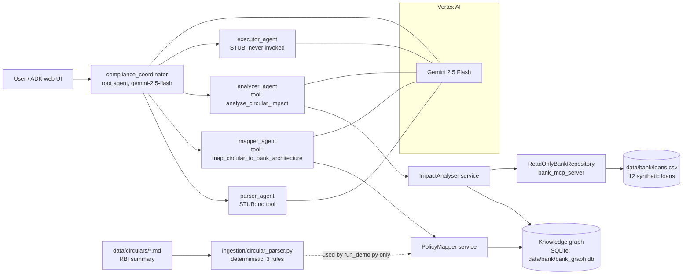
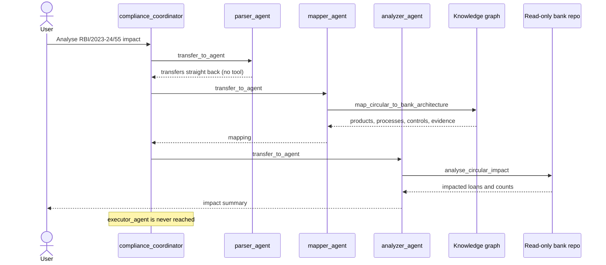
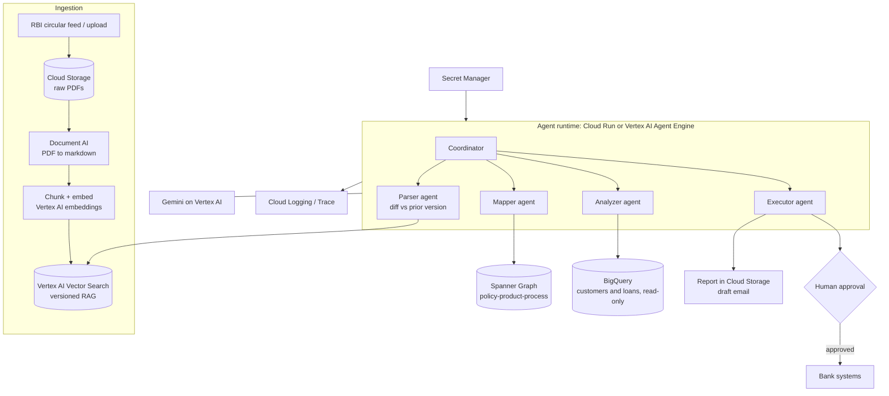
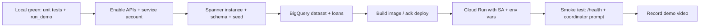

# Current design (as-is) and roadmap to the Google stack

Status date: 2026-10-12. Branch: `feature/policy-impact-pipeline`.

## 1. What this is

A Banking Policy Intelligence & Compliance Impact Engine. An RBI circular goes in. The system extracts the rules, maps them to the bank's products and processes, and computes the blast radius on customers. It is built on Google ADK with Gemini 2.5 Flash on Vertex AI.

Principle: deterministic code does the critical steps (rule extraction, counting, eligibility). The LLM routes, explains and drafts. The graph holds relationships only. Customer data stays in SQL/BigQuery.

## 2. Current setup (as-is)

### 2.1 Component view



### 2.2 Request flow actually observed in `adk web`



### 2.3 Deterministic path (no LLM)

`python scripts/run_demo.py --output artifacts/floating-rate-impact.json` runs parser → mapper → analyser directly. Result on the synthetic data:

| Metric | Value |
|---|---|
| Rules extracted | 3 (notify rate reset, fixed-rate choice, reset statement) |
| Active floating-rate loans in scope | 10 |
| Customers to notify | 6 |
| Loans lacking reset statement | 3 |
| Loans lacking fixed-rate option | 3 |
| Loans lacking EMI/tenor choice | 0 |

### 2.4 What exists, by area

| Area | Path | State |
|---|---|---|
| Agents | `agents/compliance_coordinator/` | Coordinator, mapper and analyzer are real. Parser and executor are prompt-only stubs. |
| Ingestion | `ingestion/circular_parser.py` | Regex/rule extraction for one circular type. No PDF handling, chunking or RAG. |
| Graph | `knowledge_graph/` | SQLite `BankKnowledgeGraph`. Same Nodes/Edges shape as the Spanner DDL. |
| Data access | `bank_mcp_server/` | Read-only repository and MCP server. |
| Data | `data/bank/`, `data/circulars/` | Synthetic architecture and loans. The circular is a web summary, not the PDF. |
| Cloud infra | `infrastructure/spanner_graph/` | DDL and deploy script. Not yet run against a real instance. |
| Tests | `tests/test_policy_impact.py` | 3 unittest tests passing. |

### 2.5 Known gaps

1. `parser_agent` has no tool, so it does nothing.
2. `executor_agent` is never invoked and no report or notification is produced.
3. Input is a summary, with no PDF to markdown, RAG store or diff against prior versions.
4. Data is 12 fabricated loans with no customer, family or account relationships.
5. `adk web` needs `PYTHONPATH` set to the repo root.
6. `pytest` is not installed. Tests run with `unittest`.
7. No human-approval step for any action that touches bank systems.
8. Nothing is deployed. Everything runs on a laptop.

## 3. Target design (Google stack)



Mapping from today to target:

| Today | Target |
|---|---|
| SQLite graph | Spanner Graph (DDL already written) |
| `loans.csv` | BigQuery table behind the read-only repository |
| Circular summary `.md` | Cloud Storage PDF, then Document AI, then Vector Search |
| `adk web` on laptop | Cloud Run (or Agent Engine) service |
| `.env` file | Secret Manager and a runtime service account |

## 4. Steps to set up locally

```bash
cd /Users/ssanapala/Documents/shiva/yukdhis

# 1. Python environment (3.11+ works; 3.14 is what is in use today)
python -m venv .venv
source .venv/bin/activate
pip install -r requirements.txt

# 2. Model config for ADK (file is gitignored; never commit it)
cp .env.example agents/compliance_coordinator/.env
#    edit: GOOGLE_CLOUD_PROJECT=<your project>, GOOGLE_CLOUD_LOCATION=us-central1
#    GOOGLE_GENAI_USE_ENTERPRISE=1 selects Vertex AI

# 3. Seed the local graph and run the deterministic demo (no LLM needed)
python scripts/seed_demo_data.py
python scripts/run_demo.py --output artifacts/floating-rate-impact.json

# 4. Tests
python -m unittest discover -s tests -t .

# 5. Run the agents (needs section 5 auth)
export PYTHONPATH="$PWD"
adk web agents          # UI at http://localhost:8000, pick compliance_coordinator
# or: adk run agents/compliance_coordinator
```

Try this prompt in the UI: "Analyse the impact of RBI/2023-24/55 on our floating-rate EMI loans." Check the Events panel for the transfer chain.

## 5. Steps for gcloud

```bash
# Auth and project
gcloud auth login
gcloud auth application-default login          # ADC used by ADK and Spanner clients
gcloud config set project <PROJECT_ID>
gcloud auth application-default set-quota-project <PROJECT_ID>

# Enable APIs
gcloud services enable \
  aiplatform.googleapis.com \
  spanner.googleapis.com \
  bigquery.googleapis.com \
  documentai.googleapis.com \
  run.googleapis.com \
  artifactregistry.googleapis.com \
  cloudbuild.googleapis.com \
  secretmanager.googleapis.com \
  storage.googleapis.com

# Confirm the model is reachable (gemini-2.5-flash worked in us-central1)
curl -s -H "Authorization: Bearer $(gcloud auth print-access-token)" \
  -H "x-goog-user-project: <PROJECT_ID>" \
  "https://us-central1-aiplatform.googleapis.com/v1beta1/publishers/google/models/gemini-2.5-flash" | head
```

Note: the earlier `gemini-3.8-flash` ID does not exist. Keep `gemini-2.5-flash` unless a newer ID is confirmed through the call above.

### 5.1 Spanner Graph

```bash
export SPANNER_INSTANCE=yukdhis-graph
export SPANNER_DATABASE=bank-graph

gcloud spanner instances create $SPANNER_INSTANCE \
  --config=regional-us-central1 --description="Yukdhis graph" \
  --edition=ENTERPRISE --processing-units=100      # Spanner Graph needs Enterprise

gcloud spanner databases create $SPANNER_DATABASE --instance=$SPANNER_INSTANCE
bash infrastructure/spanner_graph/deploy.sh        # applies schema.ddl
BANK_GRAPH_BACKEND=spanner python scripts/seed_spanner_graph.py
```

### 5.2 BigQuery for loan data (replaces `loans.csv`)

```bash
bq mk --dataset --location=US <PROJECT_ID>:bank_demo
bq load --autodetect --source_format=CSV bank_demo.loans data/bank/loans.csv
```

The repository adapter must use parameterized, read-only queries and a read-only service account.

### 5.3 Service accounts

```bash
gcloud iam service-accounts create yukdhis-runtime
SA=yukdhis-runtime@<PROJECT_ID>.iam.gserviceaccount.com
for r in roles/aiplatform.user roles/spanner.databaseUser \
         roles/bigquery.dataViewer roles/bigquery.jobUser \
         roles/secretmanager.secretAccessor; do
  gcloud projects add-iam-policy-binding <PROJECT_ID> --member=serviceAccount:$SA --role=$r
done
```

Use a separate, tighter identity for Spanner DDL changes.

## 6. Steps to deploy on the Google stack

### Option A: Cloud Run (recommended for the hackathon prototype link)

```bash
# Dockerfile still to be added (see 7). Base: python:3.11-slim, non-root, reads $PORT.
gcloud artifacts repositories create yukdhis --repository-format=docker --location=us-central1

gcloud run deploy yukdhis \
  --source . \
  --region us-central1 \
  --service-account $SA \
  --set-env-vars GOOGLE_GENAI_USE_ENTERPRISE=1,GOOGLE_CLOUD_PROJECT=<PROJECT_ID>,GOOGLE_CLOUD_LOCATION=us-central1,BANK_GRAPH_BACKEND=spanner,SPANNER_INSTANCE=$SPANNER_INSTANCE,SPANNER_DATABASE=$SPANNER_DATABASE \
  --no-allow-unauthenticated
```

ADK can also deploy directly: `adk deploy cloud_run --project <PROJECT_ID> --region us-central1 agents/compliance_coordinator`.
For a public judge-facing link, put the service behind IAP or share with `--member=user:<email> --role=roles/run.invoker`, rather than opening it to everyone.

### Option B: Vertex AI Agent Engine

`adk deploy agent_engine --project <PROJECT_ID> --region us-central1 --staging_bucket gs://<BUCKET> agents/compliance_coordinator`. Managed sessions and scaling, less control over the container.

### Deployment sequence



## 7. Next steps, in order

| # | Step | Outcome |
|---|---|---|
| 1 | Give `parser_agent` a real tool and make the coordinator always end with `executor_agent` | Full 4-hop trace |
| 2 | Build the executor: impact report to Cloud Storage and a notification draft. Bank changes need human approval | Demo shows an actionable output |
| 3 | Use the real RBI PDF: Document AI to markdown, chunking, versioned store, diff against prior circular | Real ingestion story |
| 4 | Richer data: more loans, customers, family and account links | Graph shows value over plain SQL |
| 5 | Add `Dockerfile`, `.dockerignore`, `/health`, and `PYTHONPATH` handling | Deployable container |
| 6 | Run the Spanner Graph and BigQuery steps above | Cloud-backed demo |
| 7 | Deploy to Cloud Run, smoke test | Prototype link |
| 8 | Submission by the 18th: pitch deck, 3-4 minute demo video, repo, and a write-up of Google tech used (ADK, Gemini on Vertex AI, Spanner Graph, BigQuery, Document AI, Cloud Run) | Deliverables complete |

Suggested time boxing: steps 1-2 first (they complete the demo flow), then 5-7 (so a link exists early), then 3-4 if time allows.

## 8. Risks

- Spanner Graph and Document AI are the most likely to eat time. Keep SQLite and the markdown summary as a working fallback for the video.
- Spanner instances bill while they exist. Delete or scale down after the demo.
- The LLM must not decide eligibility. The analyser's counts are the source of truth.
- Keep PII out of graph attributes and out of logs.
