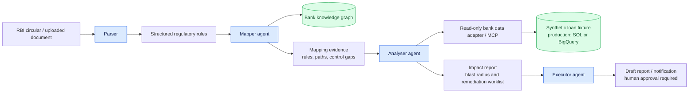
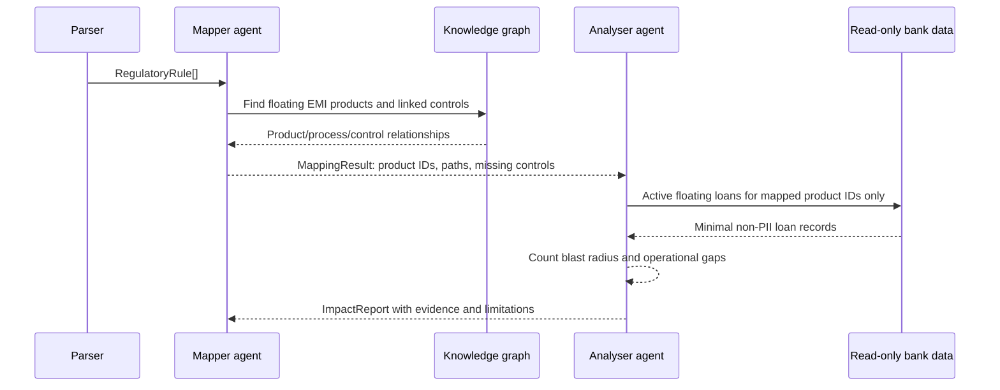
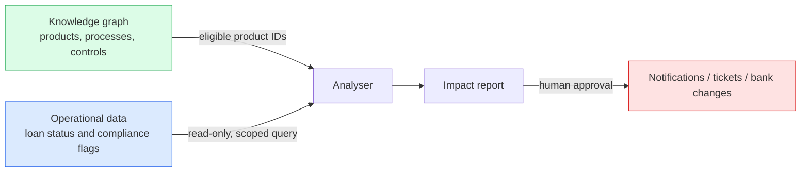
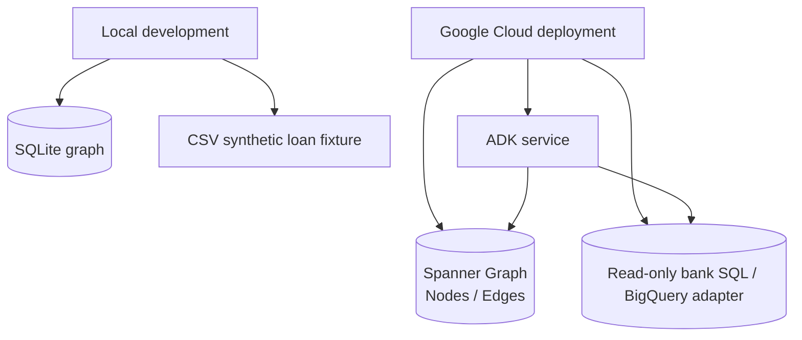

# Yukdhis design

## Purpose

Yukdhis turns a regulatory circular into an auditable compliance-impact report. It first identifies which parts of the bank architecture a rule touches, then uses that scoped result to calculate the operational blast radius. The current demo uses only synthetic, non-PII loan data.

## End-to-end flow



The coordinator is an ADK root agent. It routes new policy material in this order: **parser → mapper → analyser → executor**. The mapper never looks up customer or loan records. The analyser receives the mapper's product scope and is the only stage that joins it with read-only operational data.

## Agent responsibilities

| Component | Responsibility | Current implementation |
| --- | --- | --- |
| Parser | Extract normalized requirements, effective date, applicability and source evidence from a supported circular. | Deterministic extractor for the RBI floating-rate reset sample. PDF/RAG ingestion is the next extension. |
| Mapper | Resolve each rule to products, processes and controls; emit every traversed path and architecture-level control gap. | `PolicyMapper` over the bank graph. |
| Analyser | Query only the mapper-selected products, calculate impacted active loans and operational gaps. | `ImpactAnalyser` with `ReadOnlyBankRepository`. |
| Executor | Draft safe reports or notifications; never mutate bank systems automatically. | ADK executor agent prompt. |
| Coordinator | Enforce the hand-off order and assemble the user-facing workflow. | ADK root agent. |

## Mapper-to-analyser hand-off



`MappingResult` is the boundary contract. It contains the source rule, affected product IDs, process/control IDs, graph paths, and missing capabilities. The analyser returns an `ImpactReport` with aggregate counts, the minimal loan worklist, required actions, and limitations.

## Knowledge graph

The graph contains bank topology, not customer PII. Operational data remains in a separate read-only repository. The local graph uses SQLite tables; `infrastructure/spanner_graph/schema.ddl` creates the matching `Nodes` and `Edges` topology and a `BankArchitecture` Spanner property graph.

```mermaid
flowchart TB
    R[Regulatory rule] -->|maps to| P[Product]
    IP[Internal policy] -->|governs| P
    S[Customer segment] -->|eligible for| P
    P -->|uses| PR[Process]
    P -->|provides| C[Control]
    PR --> N[Borrower notification]
    C --> F[Fixed-rate conversion]
    C --> ET[EMI or tenor choice]
    C --> RS[Reset statement disclosure]

    classDef graph fill:#fef3c7,stroke:#d97706,color:#78350f;
    class R,P,IP,S,PR,C,N,F,ET,RS graph;
```

The included architecture has three floating-rate EMI products:

| Product | Owner | Example graph coverage |
| --- | --- | --- |
| Flexi Personal Loan | Retail Lending | Rate reset, borrower notification, fixed-rate option, EMI/tenor choice |
| EasyHome Floating Loan | Retail Lending | Rate reset, borrower notification, fixed-rate option, EMI/tenor choice, reset statement |
| DriveNow Floating Loan | Vehicle Finance | Rate reset, borrower notification, EMI/tenor choice; fixed-rate option is intentionally absent to demonstrate a graph control gap |

## Data and safety boundaries



- The demo fixture has opaque customer references only; no names, addresses, account numbers, or contact information.
- Eligibility, product selection and gap counts are deterministic code.
- An LLM may classify, summarize or structure documents, but it is not the final authority for a compliance decision.
- The MCP facade exposes only a minimal, read-only loan query.
- Any notification, ticket, or bank-system change remains a proposed action pending human approval.

## Repository layout

```text
yukdhis/
├── agents/compliance_coordinator/
│   ├── agent.py                         # ADK coordinator and routing order
│   └── sub_agents/
│       ├── parser/agent.py              # document-rule extraction agent
│       ├── mapper/
│       │   ├── agent.py                 # mapper ADK tool facade
│       │   └── service.py               # deterministic graph mapping
│       ├── analyzer/
│       │   ├── agent.py                 # analyser ADK tool facade
│       │   └── service.py               # impact calculation
│       └── executor/agent.py            # safe action drafting
├── bank_mcp_server/
│   ├── repository.py                    # read-only operational data adapter
│   └── server.py                        # optional MCP tool server
├── data/
│   ├── bank/
│   │   ├── architecture.json            # versioned graph fixture
│   │   └── loans.csv                    # synthetic loan fixture
│   └── circulars/                       # normalized source circulars
├── ingestion/circular_parser.py         # deterministic sample parser
├── knowledge_graph/
│   ├── models.py                        # MappingResult and ImpactReport contracts
│   └── store.py                         # SQLite and Spanner graph adapters
├── infrastructure/spanner_graph/
│   ├── schema.ddl                       # Spanner Graph schema
│   └── deploy.sh                        # DDL deployment command
├── scripts/
│   ├── run_demo.py                      # parser → mapper → analyser demo
│   ├── seed_demo_data.py                # local graph seed
│   └── seed_spanner_graph.py            # cloud graph seed
└── tests/test_policy_impact.py           # deterministic pipeline tests
```

## Deployment model



Local mode is the default. Set `BANK_GRAPH_BACKEND=spanner` together with `GOOGLE_CLOUD_PROJECT`, `SPANNER_INSTANCE`, and `SPANNER_DATABASE` to select the cloud graph adapter. The deployment commands, required roles, and seed steps are in [deployment.md](deployment.md).

## Current demonstration scenario

The supplied RBI circular on floating-rate EMI personal loans produces three structured requirements: borrower notification with EMI/tenor impact, a fixed-rate option, and a reset statement. Against the synthetic fixture, the demo reports 10 active floating-rate loans, 6 borrower notifications due, 3 missing reset statements, and 3 loans without a fixed-rate option. These are demo facts, not real bank findings.
