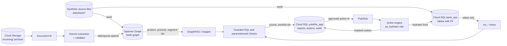
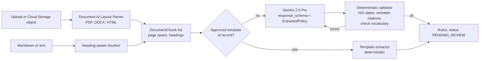
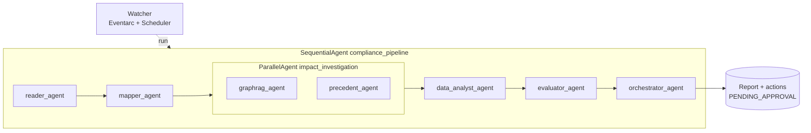
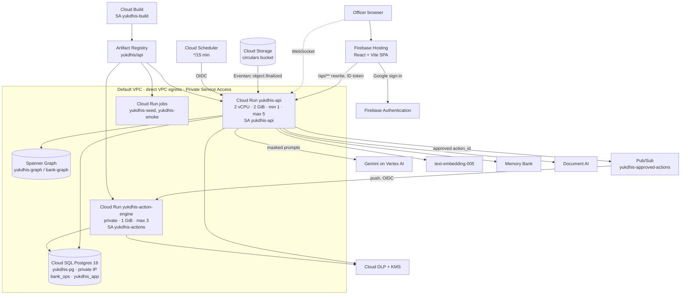

# Yukdhis: Design (single source of truth)

Status: deployed to Google Cloud project `project-b3f4c857-8b43-4c3b-84c`, region `us-central1`.
Last checked: 17 Oct 2026, against the deployed Spanner graph, Cloud SQL databases and Cloud Run services and the code in this repo.

Live: UI https://project-b3f4c857-8b43-4c3b-84c.web.app · API https://yukdhis-api-mezbfk5cha-uc.a.run.app

This is the only design document. It replaces the earlier design, architecture, GCP architecture and roadmap files, which have been removed; their history is in git.
Runbook steps are in [deployment.md](deployment.md). Eval findings are in [evals/](evals/).

---

## 1. Purpose and principles

Yukdhis turns a regulatory circular into an auditable impact report for a bank. It extracts the rules, maps them onto
the bank's products, processes and controls, traces the blast radius, measures violations in operational data, and
proposes remediation. A compliance officer approves each action.

1. **Deterministic numbers.** Counts, penalties and product scope come from code. The LLM routes, reasons, drafts and
   explains. It never decides eligibility.
2. **Topology and records are separate stores.** The graph holds structure only. Loans and customers live in SQL.
3. **No PII to the model.** Agents see masked text, aggregates, opaque references and session tokens.
4. **Human approval before any change.** Every remediation is a proposal until an officer approves it.
5. **Bitemporal history.** Relationships carry business time and system time, so a past decision can be replayed.
6. **Multi-tenant by construction.** Every graph row and app record carries `tenant_id`. Onboarding a bank means mapping its
   core-banking data onto the BIAN ontology; the agents do not change.

---

## 2. Where the data lives

Short answer: **both.** The graph database holds bank *structure*. The SQL database holds bank *records*, including
the synthetic customer PII. The two are never joined inside the graph.

| # | Data | Store (GCP) | Location | Rows (17 Oct 2026) | Contains PII? | Written by | Read by |
| --- | --- | --- | --- | --- | --- | --- | --- |
| 1 | **Bank topology and policy graph** (products, processes, controls, teams, branches, segments, policies, rules) | **Spanner Graph** (Enterprise, 100 PU) | instance `yukdhis-graph`, database `bank-graph`, tables `Nodes` and `Edges`, property graph `BankArchitecture` | Nodes 56 (33 seed + 23 created by runs), Edges 203 (64 seed + runtime edges; superseded versions are kept) | **No** | Seed script (`scripts/seed_spanner_graph.py`) and the mapper at run time | GraphRAG agent (GQL), evaluator (control gaps), chat assistant |
| 2 | **Operational bank records**: branches, customers, loans, loan events | **Cloud SQL Postgres 16**, database `bank_ops` (private IP, IAM auth) | tables `branches` (6), `customers` (120), `loans` (161), `loan_events` (401) | as shown | **Yes, synthetic.** `customers` has name, email, phone, PAN. `branches` has manager name and email. | Seed job (`scripts/seed_cloudsql.py`) | Only through the views below, and by the `pii_hydrator` role for approved actions |
| 2a | Sanitized views over (2) | Cloud SQL `bank_ops` | `vw_compliance_impact`, `vw_loan_events`, `vw_branch_directory` | derived | **No** (opaque refs only) | DDL | Data analyst and evaluator, via the `compliance_analyst` role |
| 3 | **App state**: ADK sessions, runs, run events, reports, actions, worklists, audit log, outbox, processed-object markers | **Cloud SQL Postgres 16**, database `yukdhis_app` | ADK session tables (created by `DatabaseSessionService`), `runs`, `run_events`, `reports`, `actions`, `worklists`, `audit_log`, `outbox`, `processed_objects`, `conversations`, `chat_messages` | grows with use | Worklists hold opaque loan and customer refs. The outbox holds masked recipients. | API and action engine | UI, API, assistant |
| 4 | **Circulars and archives** | **Cloud Storage** `project-b3f4c857-8b43-4c3b-84c-yukdhis-circulars` | `incoming/` (Watcher input), `archive/<doc_id>/` (retained uploads) | per upload | Depends on the document | API, Eventarc | Document AI |
| 5 | **Long-term memory** | **Vertex AI Agent Engine, Memory Bank** | engine id stored in `.state.env` | per completed session | Distilled summaries (masked) | Pipeline after each run | Precedent agent, assistant |
| 6 | **Synthetic source files** (seed inputs) | Git repo | `data/bank/architecture.json`, `data/bank/operational/*.csv`, `data/bank/manifest.json` | fixed, seed 2026 | Synthetic PII | `scripts/generate_synthetic_bank.py` | seed jobs; local mode |
| 7 | Local development copies | SQLite files in `.data/` (gitignored) | `graph.db`, `operational.db`, `app.db`, `sessions.db` | rebuilt from (6) | Synthetic PII in `operational.db` | local backends | local runs and tests |

Data flow across the stores:

The graph is consulted to decide **where to look**. The SQL views say **which records are affected**. The action
engine is the only component that resolves a worklist entry to a named customer.

---

## 3. Bank model (what the engine knows about a bank)

### 3.1 Canonical ontology (BIAN-aligned, shared by all tenants)

Defined in `knowledge_graph/ontology.py`.

| Node label | Meaning | Example (demo bank) |
| --- | --- | --- |
| `Policy` | Regulatory or internal document | `policy:A.P. (DIR Series) Circular No. 27` |
| `Rule` | Executable clause with checks | `rule:…:1` |
| `Product` | Banking product | Flexi Personal Loan, DriveNow Floating Loan, GoldEase Loan |
| `Process` | Business process mapped to a BIAN domain | Benchmark Rate Reset, Loan Closure, Collateral Release |
| `Control` | Capability a product provides | EMI or Tenor Choice, Fixed Rate Conversion Option, 30-day Document Release Tracker |
| `CustomerSegment` | Abstract grouping, never individuals | Retail Individual Borrower, MSME Borrower |
| `Team` | Accountable owner | Retail Lending, Vehicle Finance, Lending Operations, Customer Communications, Collateral Operations, MSME Banking |
| `Branch` | Operational unit | Koramangala (Bengaluru), Andheri East (Mumbai), … (6 branches) |

Edge types: `CONTAINS`, `SUPERSEDES`, `GOVERNS` (Rule→Product), `APPLIES_TO` (Rule→Process), `TARGETS` (Rule→Segment),
`REQUIRES` (Rule→Control), `USES` (Product→Process), `PROVIDES` (Product→Control), `OWNED_BY` (→Team),
`ELIGIBLE_FOR` (Segment→Product), `OFFERED_AT` (Product→Branch).

Every edge carries `valid_from` / `valid_to` (business time) and `recorded_at` / `superseded_at` (system time).
Re-writing an edge with different attributes supersedes the old row instead of overwriting it.

### 3.2 Seed topology (`data/bank/architecture.json`, 33 nodes, 64 edges)

| Product | Rate type | Secured | Notes |
| --- | --- | --- | --- |
| Flexi Personal Loan (`personal-loan-floating`) | Floating EMI | No | Retail Lending |
| EasyHome Floating Loan (`home-loan-floating`) | Floating EMI | Immovable | Retail Lending |
| DriveNow Floating Loan (`auto-loan-floating`) | Floating EMI | Movable | Vehicle Finance. Fixed-rate switch expired 1 Jul 2024 (bitemporal demo) |
| Flexi Personal Loan Fixed (`personal-loan-fixed`) | Fixed EMI | No | Retail Lending |
| PropertyPlus LAP (`loan-against-property`) | Fixed EMI | Immovable | Retail Lending |
| GoldEase Loan (`gold-loan`) | Fixed, bullet | Movable | Retail Lending |
| MSME Growth Term Loan (`msme-term-loan`) | Floating EMI | Immovable | MSME Banking |

Seed controls: borrower notification, EMI or tenor choice, fixed-rate option, reset statement, document release SLA,
delay compensation, document collection choice.

### 3.3 Operational schema (`bank_ops`, Cloud SQL)

| Table | Key columns | Notes |
| --- | --- | --- |
| `branches` | `branch_id`, name, city, region, manager_name, manager_email | Manager contact is PII |
| `customers` | `customer_id`, `customer_ref` (unique, opaque), full_name, email, phone, pan, segment_id, branch_id | PII. Only `customer_ref` leaves the database |
| `loans` | `loan_id`, `loan_ref` (unique, opaque), customer_id, product_id, status, rate_type, emi_amount, outstanding_balance, sanctioned_on, closed_on, rate_reset_due, and four boolean compliance flags | Flags: `borrower_notified`, `has_fixed_rate_option`, `has_emi_tenor_choice`, `statement_available` |
| `loan_events` | event_id, loan_id, event_type, occurred_on | Types: LOAN_DISBURSED, LOAN_CLOSED, DOCUMENTS_RELEASED, RATE_RESET, RATE_RESET_NOTICE_SENT |

Views (the only surface agents may read):

| View | Columns exposed | Excludes |
| --- | --- | --- |
| `vw_compliance_impact` | loan_ref, customer_ref, product_id, segment_id, branch_id, status, rate_type, amounts, dates, four flags | names, emails, phones, PAN, customer_id |
| `vw_loan_events` | loan_ref, customer_ref, product_id, branch_id, segment_id, event_type, occurred_on | identities |
| `vw_branch_directory` | branch_id, branch_name, city, region | manager name and email |

Database roles: `compliance_analyst` (SELECT on the three views only; sessions are READ ONLY with a 5 s statement timeout).
`pii_hydrator` (column-level SELECT on loan refs, customer name, email and branch manager contact; used only by the action
engine).

### 3.4 Synthetic data (`scripts/generate_synthetic_bank.py`, seed 2026, reference date 17 Oct 2026)

- 6 branches, 120 customers, 161 loans, 401 loan events.
- Planted scenario for RBI/2023-24/60 (document release within 30 days): 12 violations, 7 at Koramangala.
- All names, emails, phones and PANs are fictional. Every synthetic customer uses an `example.com` address.

---

## 4. Rule extraction (ingestion)

- The template extractors (`ingestion/templates.py`) cover the two RBI circulars in the demo. When one matches, the template is
  the source of truth and Gemini's output is scored against it.
- The validator requires every citation to appear verbatim in the source, dates to be ISO, and each check to use the ontology
  vocabulary (`control_required`, `record_flag`, `event_deadline`). It allows one corrective retry.
- Every extracted rule starts as `PENDING_REVIEW`. A reviewer approves it with `POST /api/rules/review`, which versions its
  graph edges.
- Known limitations are listed in §12.

---

## 5. Agent pipeline (Google ADK)

| Agent | Model | Tools | Guarantee |
| --- | --- | --- | --- |
| `reader_agent` | Gemini 2.5 Pro | `parse_regulatory_document`, `extract_and_validate_rules` | Structured output, validator, template of record |
| `mapper_agent` | Gemini 2.5 Flash | `get_graph_ontology`, `map_rules_to_graph` | Scoring and resolution are deterministic (§6) |
| `graphrag_agent` | Gemini 2.5 Flash | `traverse_blast_radius`, and `run_graph_query` on GCP | GQL is read-only, `@tenant_id` bound, LIMIT 200 |
| `precedent_agent` | Gemini 2.5 Flash | `recall_precedents`, `load_memory` | Read-only history |
| `data_analyst_agent` | Gemini 2.5 Flash | `profile_impacted_portfolio`, `run_safe_sql` | sqlglot AST guard: one SELECT, `vw_*` only, aggregates only, LIMIT 100 |
| `evaluator_agent` | Gemini 2.5 Pro | `evaluate_compliance`, `fetch_anonymized_samples` | Parameterised checks, worklists stay in the database |
| `orchestrator_agent` | Gemini 2.5 Pro | `trigger_compliance_workflow`, `finalize_impact_report` | Proposals only, placeholder-only notice text |
| `compliance_assistant` (separate agent) | Gemini 2.5 Pro | list and get reports, time-travel blast radius, ontology, `run_safe_sql`, `load_memory`, `preload_memory` | Same read surface as the pipeline |

- Agents pass structured results through session state (`document`, `extraction`, `mappings`, `blast_radius`, `results`,
  `actions`, `report_id`), not through prose.
- Every LLM request passes through `before_model_callback` (`privacy/callbacks.py`), which masks PII.
- Each run has a tool-call budget (40 per turn).
- Deterministic mode runs the same stage functions (`pipeline/stages.py`) without an LLM, so the numbers are identical.

---

## 6. Deterministic core

**Mapper** (`knowledge_graph/mapper.py`):
- Product scope comes from explicit attribute filters, a regulatory glossary (for example, "personal loans" means all
  retail individual loans), and scored entity resolution. A term that does not resolve is reported with its score.
- **Fail-closed.** If a rule names products and none resolve (and no filter narrows it), it governs **no** products and its
  mapping is `scope_status = UNRESOLVED` with notes. Segment terms that do not resolve give no segments; the
  eligible-segment fallback applies only when the rule listed no segment terms.
- Entity resolution (`knowledge_graph/entity_resolution.py`) takes the higher of a lexical synonym score (threshold 0.55)
  and a Vertex AI embedding score (`text-embedding-005`, GCP only, threshold 0.75). Regulated-entity wording ("banks",
  "Authorised Dealers", "NBFCs") never resolves to a product or customer segment.
- Unknown capabilities create `Control` nodes with `needs_review = true`.

**GraphRAG traversal** (`knowledge_graph/traversal.py`): Rule → Product, Process, Segment, Control (hop 1), then
Product → Process, Control, Team (hop 2), all filtered by `as_of`. Output is topology only.

**Evaluator** (`bank_mcp_server/secure_engine.py`):
- `record_flag`: boolean on `vw_compliance_impact` differs from the expected value.
- `control_required`: product lacks a `PROVIDES` edge to the required control at `as_of`.
- `event_deadline`: trigger event on or after the rule's effective date, followed by a required event within N days.
  Penalty is delay days × rate.
- Each check writes a worklist (opaque refs) and returns its `worklist_id`. The model never sees the rows.
- `control_required` and `record_flag` count **active** loans only, unless the rule targets closures (it has an
  `event_deadline` on `LOAN_CLOSED`) or sets an explicit record status.

**Statuses.** A check is `COMPLIANT`, `GAP`, `NOT_EVALUATED` or `UPCOMING`:
- `UPCOMING`: the rule's effective date is after the analysis date, so readiness is not assessed.
- `NOT_EVALUATED`: the scope is `UNRESOLVED`, no products are governed, or the rule's modality is `MAY` (a permission, not
  an obligation).

The report's `overall_status` rolls up as: any `GAP` → `NON_COMPLIANT`; else any `UPCOMING` → `UPCOMING`; else no results,
any `NOT_EVALUATED` or any unresolved rule → `INCONCLUSIVE`; else `COMPLIANT`. `summary.unresolved_rules` lists the rules
whose scope could not be resolved. No remediation action is proposed for a rule without a `GAP`.

**Rule approval**: a human decision on a rule re-versions its edges (`ingestion` → `knowledge_graph/mapper.py: review_rule`).

---

## 7. Privacy and security

| Concern | Control |
| --- | --- |
| PII reaches Gemini | `before_model_callback` masks text. On GCP, Cloud DLP de-identifies built-in infoTypes (name, email, phone, PAN, Aadhaar, card, IBAN, account) using a crypto-deterministic surrogate with a KMS-wrapped key (`YUKDHIS_TOKEN`). Tool output gets a regex scrub. The local Aadhaar pattern is checksum-validated (Verhoeff) and ignores identifiers such as `rpt-…`; card numbers must pass Luhn. |
| Contextual PII | Gemma redactor (`privacy/gemma.py`) is **switched off** (see §9.4). Contextual names are found by a heuristic only, so coverage is weaker than planned. |
| Local vault | Local mode only: AES-GCM tokens `{{TYPE_N}}` in process memory, TTL 1 h. |
| SQL exfiltration | DB role (views only, READ ONLY session) plus the sqlglot AST guard. |
| Graph writes by the LLM | Not possible. Agents read through guarded GQL. Writes happen only in the deterministic mapper. |
| Approval | Every workflow is a proposal. A human decision moves it from `PENDING_APPROVAL` to `APPROVED` atomically. Approving an action whose rule has an `UNRESOLVED` scope returns 409 (rejecting is always allowed). |
| Hydration | Action engine only, separate service account, private ingress, `pii_hydrator` role. |
| AuthN | Firebase ID token for officers (optional `ALLOWED_EMAIL_DOMAIN`). Google OIDC for Eventarc, Scheduler and Pub/Sub. WebSocket token is sent in the first frame, never in the URL. |
| Network | Cloud SQL has private IP only. Cloud Run uses direct VPC egress to private ranges. The action engine has no public ingress. |
| Secrets | Secret Manager holds `yukdhis-dlp-wrapped-key` and `yukdhis-sql-admin`. Runtime DB users use IAM auth. No secret is in code, images or logs. |
| Abuse | Per-IP rate limit (60 POST/min), upload size and type checks, PDF magic-byte check, security headers, CSP on Hosting. |
| Audit | `audit_log` records the LLM intent and the executed query for every engine call, human decisions with the officer's email, and rule decisions. |

---

## 8. Human-in-the-loop and action engine

1. Officer approves in the UI: `POST /api/actions/{id}/decision`. Status moves to `APPROVED` only from `PENDING_APPROVAL`
   (a second approval returns 409).
2. The API publishes `{action_id}` to Pub/Sub topic `yukdhis-approved-actions`. The message contains no PII.
3. The push subscription calls the action engine at `/internal/actions/dispatch` with an OIDC token from `yukdhis-events`.
4. The action engine loads the worklist and hydrates recipients with `pii_hydrator`, renders the notice, and writes masked
   recipients to `outbox`. Real delivery would go through the bank's notification gateway, which is not built.
5. Status becomes `DISPATCHED`.

Workflow types: `SEND_BORROWER_NOTICE`, `BRANCH_MANAGER_ALERT`, `PRODUCT_CONTROL_CHANGE`, `COMPENSATION_PAYOUT_REVIEW`.
Each action carries an `owner` team: the team owning the rule's processes, else the products' owner, else Compliance
(always Compliance when the scope is unresolved). Treasury ownership needs the Treasury domain (see §12).

---

## 9. Google Cloud deployment

### 9.1 Topology

### 9.2 Resource inventory (verified 17 Oct 2026)

| Layer | Resource | Configuration |
| --- | --- | --- |
| Hosting | Firebase Hosting, `project-b3f4c857-8b43-4c3b-84c.web.app` | SPA, CSP, HSTS, X-Frame-Options DENY, `/api/**` rewrite to `yukdhis-api` |
| Auth | Firebase Authentication | Google provider |
| Compute | Cloud Run `yukdhis-api` | 2 vCPU, 2 GiB, min 1 / max 5, CPU always allocated, 900 s timeout |
| | Cloud Run `yukdhis-action-engine` | 1 GiB, max 3, no public access |
| | Cloud Run jobs `yukdhis-seed`, `yukdhis-smoke` | Same image, inside the VPC |
| Data | Spanner instance `yukdhis-graph` (Enterprise, 100 PU, regional us-central1), database `bank-graph` | DDL from `infrastructure/spanner_graph/schema.ddl` |
| | Cloud SQL `yukdhis-pg` (Postgres 16, Enterprise, db-custom-1-3840, private IP, IAM auth, backups on) | Databases `bank_ops`, `yukdhis_app`, `postgres`. Activation policy ALWAYS (running) |
| | Cloud Storage bucket `…-yukdhis-circulars` | Uniform access, public access prevention |
| AI | Vertex AI Gemini 2.5 Pro and Flash, `text-embedding-005`, Memory Bank (Agent Engine) | |
| | Vertex AI endpoint `yukdhis-gemma-redactor` | Exists, **0 deployed models**, no GPU billed |
| Processing | Document AI Layout Parser (`us`) | |
| | Cloud DLP | Built-in infoTypes plus custom dictionary |
| Security | Cloud KMS keyring `yukdhis`, key `dlp-wrap` | Wraps the 256-bit DLP data key |
| | Secret Manager `yukdhis-dlp-wrapped-key`, `yukdhis-sql-admin` | |
| Integration | Pub/Sub topic `yukdhis-approved-actions`, push subscription `yukdhis-action-engine` | OIDC push |
| | Eventarc trigger `yukdhis-watcher` | `storage.object.v1.finalized` → `/api/events/gcs` |
| | Cloud Scheduler `yukdhis-watch-poll` | `*/15 * * * *` → `/api/watch/poll` |
| Delivery | Artifact Registry `yukdhis` (Docker), Cloud Build | Image `api:<sha>` and `api:latest` |

### 9.3 Identities

| Identity | Granted | Not granted |
| --- | --- | --- |
| `yukdhis-api` | Vertex AI user, Spanner DB user, Cloud SQL client and instance user, Document AI user, DLP user, KMS decrypter on `dlp-wrap`, Secret accessor, Pub/Sub publisher on the topic, object admin on the bucket, log writer. DB role `compliance_analyst` | Customer PII columns |
| `yukdhis-actions` | Cloud SQL client and instance user, DLP user, KMS decrypter, Secret accessor. DB role `pii_hydrator` | Vertex AI, Spanner, public ingress |
| `yukdhis-events` | Eventarc receiver, Cloud Run invoker on the action engine | Data access |
| `yukdhis-build` | Log writer, object admin (build source), Artifact Registry writer | Runtime access |

This organisation disables automatic service-agent grants. The deploy script creates and grants the Eventarc and DLP
service agents explicitly.

### 9.4 Gemma: off

- The Gemma model was undeployed from `yukdhis-gemma-redactor` to stop GPU billing (an L4 costs roughly INR 1,700–2,000/day).
- `DEPLOY_GEMMA=0` is the default in `infrastructure/gcp/config.env.example`.
- The services run `GEMMA_BACKEND=local`. Contextual PII is found by the heuristic, and DLP still masks the rest.
- To re-enable: set `DEPLOY_GEMMA=1` and `GEMMA_MODEL` (2B fits on one L4, 9B needs two), then run `deploy.sh gemma` and `deploy.sh services`.

### 9.5 Backends and configuration

Each component is switchable with `*_BACKEND=local|gcp` (`core/config.py`). The default comes from `YUKDHIS_BACKEND`.

| Component | Local | GCP |
| --- | --- | --- |
| Graph | SQLite `.data/graph.db` | Spanner Graph |
| Operational data | SQLite `.data/operational.db`, read-only | Cloud SQL `bank_ops` (analyst and hydrator roles) |
| Document parsing | Markdown and text only | Document AI |
| Privacy | Regex, heuristic, AES-GCM vault | Cloud DLP (+ Gemma when enabled) |
| Dispatch | In-process | Pub/Sub → action engine |
| Memory | In-memory | Vertex AI Memory Bank; sessions in Cloud SQL |
| Auth | `AUTH_MODE=none` (local user) | `AUTH_MODE=firebase` |

`AGENT_MODE=agentic` runs the ADK pipeline. Without a Vertex AI project it falls back to deterministic mode.

`APP_DB_GRANTEES` (set by `deploy.sh` to the API and action-engine IAM users) makes whichever service first creates
an app-state table grant it to the other. Without it, a new table such as `conversations` is usable only by its creator.

### 9.6 Cost (approximate, INR/day)

| Item | Cost driver | Estimate |
| --- | --- | --- |
| Spanner Enterprise 100 PU | Always on, cannot pause | ~250 |
| Cloud SQL db-custom-1-3840 | ALWAYS activation policy | ~150 |
| Cloud Run API, min 1 instance, CPU always on | Always on | ~300 |
| Gemini, DLP, Document AI, Pub/Sub, Storage, Hosting | Per use | small at demo volume |
| Gemma L4 GPU | **Off** | 0 |

Options to cut further: set the API to `--min-instances=0`, or stop Cloud SQL with
`gcloud sql instances patch yukdhis-pg --activation-policy=NEVER` when it is idle. Delete Spanner after the event.

---

## 10. Runtime flows

**Analysis run.** `POST /api/runs` (file or sample) returns a run id and starts a background task. The task writes
events to `run_events`. The UI follows them over WebSocket, or by polling as a fallback, and loads the report at the end.

**Watcher.** A file in `incoming/` triggers Eventarc → `/api/events/gcs`. The OIDC token is checked, and
`processed_objects` prevents a second run for the same object. Scheduler's 15-minute poll catches anything missed.

**Chat.** `POST /api/chat` sends a message to `compliance_assistant`. Sessions are kept in Cloud SQL, and memory is read
through `preload_memory` and `load_memory`.

**Smoke test.** `gcloud run jobs execute yukdhis-smoke --wait` runs one agentic analysis inside the VPC. It checks the 12
planted violations.

---

## 11. Operations

- **Deploy:** `bash infrastructure/gcp/deploy.sh <step>` (`apis iam network storage spanner cloudsql seed documentai dlp gemma memory build services pubsub eventarc web`), then `bash infrastructure/gcp/monitoring.sh`. Idempotent. Never prompts. Resolved ids go to `infrastructure/gcp/.state.env` (gitignored).
- **Build:** `cloudbuild.yaml` runs pytest, builds, and pushes `api:<sha>` and `api:latest`.
- **Rollback:** `gcloud run services update-traffic yukdhis-api --to-revisions=<prev>=100`.
- **Logs:** Cloud Logging for every service and job. The API writes one JSON line per request (`request_id`, status,
  `latency_ms`; an inbound `X-Request-Id` is honoured and echoed) and `run_completed` / `run_failed` lines with
  `duration_s`. Run trace is in `run_events`, audit trail in `audit_log`.
- **Monitoring** (`monitoring.sh`, email `ALERT_EMAIL`): log-based metric `yukdhis_run_failed`, alert policies for
  "pipeline run failed" and "API 5xx", and a 5-minute uptime check on `/health`.
- **Not yet in place:** DLP error alert, budget alert, staging and prod separation.

---

## 12. Current state and known limitations

Verified on 17 Oct 2026 after the latest deploy: UI and API health, token enforcement (401), private action engine (403),
request-id echo, Hosting rewrite, and a full agentic smoke run (12 violations, 7 at Koramangala, ₹2.46 Cr). Replays of
FERR-like and CVA-like inputs through the real stages now give `INCONCLUSIVE` and `UPCOMING` with no actions. 21 tests pass.

Defects found by the evals in `docs/evals/` (both are real circulars):

| # | Limitation | Status |
| --- | --- | --- |
| L1 | Fail-open scope: unresolved terms mapped to all products and segments | **Fixed**: fail-closed, `scope_status`, regulated-entity stoplist, embedding threshold 0.75 |
| L2 | `NOT_EVALUATED` rolled up to `COMPLIANT` | **Fixed**: `UPCOMING` and `INCONCLUSIVE` statuses |
| L3 | No document-type classification or link following (a press release was read as a rule) | **Partly fixed**: draft or proposal wording in a citation is a validation error and the run fails with a clear message. Classifier and link following are open |
| L4 | No rule modality | **Fixed**: `MUST` / `MAY` / `MUST_NOT`; `MAY` is not evaluated as an obligation |
| L5 | No applicability gate (licence, entity type, business line) | Open |
| L6 | Re-mapping is not idempotent; rule ids are positional | Open |
| L7 | Capability names are created verbatim, giving near-duplicate controls | Open |
| L8 | Extraction is non-deterministic and not cached | **Partly fixed**: `seed=0`. No cache by `document_id` yet |
| L9 | `control_required` counted closed loans | **Fixed** |
| L10 | Owner routing used the product owner | **Partly fixed**: process owner first, Compliance when unresolved. Treasury needs its own domain |
| L11 | Approval allowed for rules with unresolved scope | **Fixed**: API returns 409; UI disables the button with the reason |
| L12 | Aadhaar regex had no checksum | **Fixed**: Verhoeff, identifier guard, Luhn for cards |
| L13 | Contextual PII detection is heuristic only, since Gemma is off | Open (cost decision) |
| L14 | The graph holds rules from test runs, including unreviewed and wrong ones (CVA, FERR) | Open |
| L15 | Orchestrator restates the mapping as fact; no critic step | Open |

Also shipped with the fixes: UI badges for all four overall statuses, an unresolved-scope warning, run comparison,
CSV export and print-to-PDF, stage timings, and responsive, dark-mode and accessibility improvements.

Data gaps for the next scenarios:

| Gap | Needed for |
| --- | --- |
| Treasury and derivatives domain: FX forwards, swaps, NDDCs, trade-level data with direction, purpose, counterparty residency, hedge designation, booking unit | RBI A.P. (DIR Series) Circular No. 27 |
| Reserve balances held with RBI | FERR shortfall |
| Regulated-entity profile (AD Category-I/II/III, IBU status, bank type) | Applicability gate (L5) |
| Capital domain: RWA by risk type, CET1, Tier 1, CRAR, netting sets, SA-CCR EAD, CDS hedges, counterparty sector and credit quality | RBI CVA Directions, effective 1 Apr 2027 |
| Current CVA baseline and charge | Gap assessment |
| Funding-curve reference data | Cost of locked cash |
| Regulatory corpus links (master directions, drafts, finals) | `AMENDS` / `SUPERSEDES` lineage |

---

## 13. Roadmap

Completed since the first prototype: the small-effort correctness, API, extraction, UI and observability fixes above, ADK pipeline, Spanner Graph and bitemporal graph, Cloud SQL with least-privilege
roles, Document AI, DLP and KMS, Memory Bank, Cloud Run, Pub/Sub action engine, Eventarc watcher, Firebase UI with
sign-in, CI, deployed smoke test, evals on two real circulars.

**P0: fail-safe outputs (mostly done).** Remaining: regulated-entity profile and applicability gate (L5), and keeping
test-run data out of the production graph (L14).

**P1: reading regulation like a compliance officer.** Document-type classifier and link following (L3). Stable
content-hash rule ids, idempotent re-mapping and control dedup (L6, L7). Extraction caching by `document_id` (L8).
Critic agent between evaluator and orchestrator (L15). Treasury owner routing (L10).

**P2: coverage.** Treasury and derivatives domain, capital adequacy domain, and FERR and CVA as working scenarios with
real numbers. Re-enable Gemma (L13) once the budget allows.

**Production path:** project per bank or VPC Service Controls perimeter, CMEK on Spanner, Cloud SQL and the bucket,
Private Service Connect for Vertex AI, staging and prod environments, Monitoring SLOs.

---

## 14. Repository map

| Path | Contents |
| --- | --- |
| `agents/compliance_coordinator/` | Pipeline agents (`agent.py`, `sub_agents/`), function tools (`tools.py`) |
| `agents/compliance_assistant/` | Chat agent |
| `api/` | FastAPI (`main.py`), runs (`runs.py`), auth, ADK runtime |
| `pipeline/` | Stage functions shared by agent tools and the deterministic runner |
| `ingestion/` | Documents, templates of record, Gemini extractor, validator, watcher |
| `knowledge_graph/` | Ontology, bitemporal store (SQLite and Spanner), mapper, traversal, GQL guard, entity resolution |
| `bank_mcp_server/` | Operational store, SQL guard, secure engine, remediation (action engine), MCP server |
| `privacy/` | Detectors, vault, Gemma client, sanitizer, ADK callback |
| `core/` | Config, typed contracts, app store, Gemini client |
| `web/` | React 19 + Vite + TypeScript UI |
| `infrastructure/gcp/` | `deploy.sh`, `config.env.example` |
| `infrastructure/spanner_graph/` | `schema.ddl`, `deploy.sh` |
| `infrastructure/cloudsql/` | `schema.sql` (tables, views, roles) |
| `scripts/` | Synthetic data generator, seeders, smoke test, demo |
| `data/` | Synthetic bank (`bank/`), circulars (`circulars/`) |
| `tests/` | `test_engine.py` (11 tests) |
| `docs/` | This file, `deployment.md`, `evals/` |
